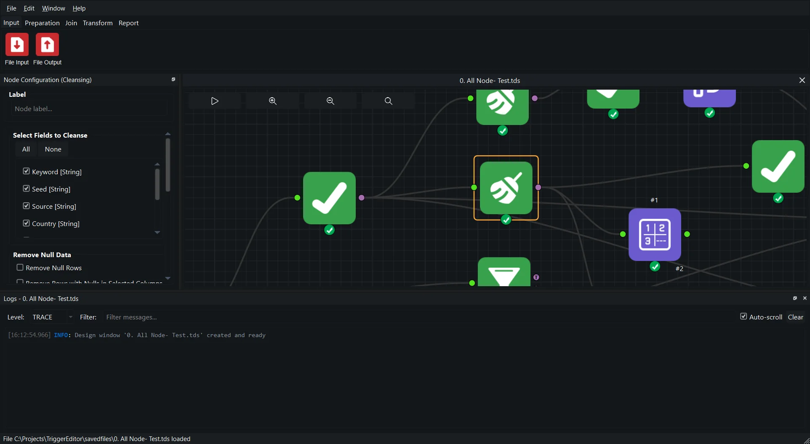

<div align="center">


# Trigger Designer

**A visual, node-based workbench for cleaning, transforming and auditing data without writing code.**



[](https://www.python.org/)
[](https://doc.qt.io/qtforpython-6/)
[](https://pola.rs/)
[](https://duckdb.org/)
[](#license)
[](#requirements)

</div>

---

Trigger Designer is a desktop application for building data-quality workflows as a graph of nodes. Drop nodes onto a canvas, wire their sockets together, and the app evaluates the pipeline live while you configure each step in the sidebar. Workflows save as portable `.tds` files and every run leaves a verifiable, signed audit trail.

**[Full documentation](https://azadkshitij.github.io/TriggerEditor/docs/)** including the user guide, node reference and formula reference.

## Quick start

Requirements: **Python 3.14+** and [**uv**](https://github.com/astral-sh/uv).

```bash
git clone https://github.com/AzadKshitij/TriggerEditor.git
cd TriggerEditor
uv sync
uv run trigger-designer
```

Open a saved workflow directly:

```bash
uv run trigger-designer "savedfiles/0. All Node- Test.tds"
```

## Headless CLI

Run a workflow without the editor, with exit codes, JSON logs and a Windows scheduling helper:

```bash
uv run trigger-designer-cli run workflow.tds
```

See the [command-line guide](https://azadkshitij.github.io/TriggerEditor/docs/guide/cli/) for full usage.

## Building a Windows executable

```powershell
scripts\build.bat                   # folder build (faster startup)
scripts\build.bat -- --portable     # single-file executable
scripts\build.bat -- --both         # both in one run
```

Output is zipped into `dist\` with a `SHA256SUMS.txt`. Compile an installer with Inno Setup using [`savedfiles/TriggerDesigner_Setup.iss`](savedfiles/TriggerDesigner_Setup.iss).

## Development

```bash
uv run --project . pytest tests/               # run tests
uv run --project . ruff format .               # format
uv run --project . ruff check .                # lint
uv run --project . ty check                    # types
uv run --project . pre-commit run --all-files  # all hooks
```

Before changing the UI, read [`AGENTS.md`](AGENTS.md) and [`docs/DESIGN_SYSTEM.md`](docs/DESIGN_SYSTEM.md).

## Docs

```bash
uv sync --group docs
uv run --group docs zensical serve    # live preview at http://127.0.0.1:8000
```

## Contributing

Contributions are welcome. See [`CONTRIBUTING.md`](CONTRIBUTING.md) for the setup and guidelines: branch off `main`, make a focused change with tests, then open a pull request.

## License

Released under the **MIT License**.

Maintainer: **Azad Kshitij** - azadkshitij08302001@gmail.com
