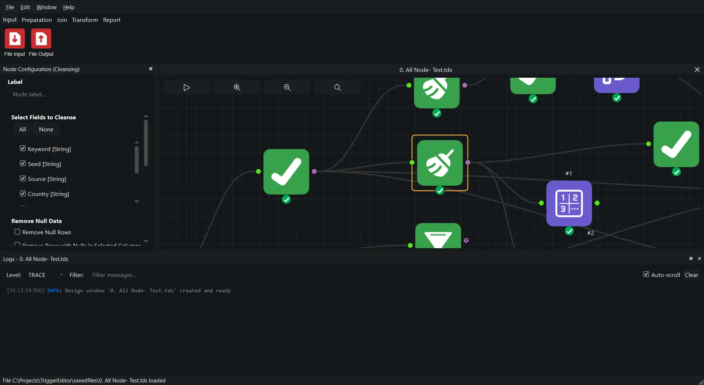

<div align="center">


# Trigger Designer

**A visual, node-based data-processing workbench — cleanse, transform, join and
preview data without writing a pipeline by hand.**



<sub>A workflow loaded in the node canvas, with the Config Dock editing a Cleansing node.</sub>

[](https://www.python.org/)
[](https://doc.qt.io/qtforpython-6/)
[](https://pola.rs/)
[](https://duckdb.org/)
[](#license)
[](#requirements)

</div>

---

Trigger Designer (repository name **TriggerEditor**) is a desktop application for
building data workflows as a graph of nodes. You drop nodes onto a canvas, wire
their output sockets into the next node's inputs, and the app evaluates the
pipeline live while you configure each step in a context-sensitive **Config
Dock**. Workflows are saved as portable `.tds` files.

Under the hood every node produces a [Polars](https://pola.rs/) DataFrame, with
[DuckDB](https://duckdb.org/) powering the SQL-like Formula editor and
[`nodeeditor-qtpy`](https://pypi.org/project/nodeeditor-qtpy/) providing the
Qt canvas.

## Features

- **Visual workflow editor** — drag, wire, label and group nodes on an infinite,
  zoomable canvas. Cut edges by drawing over them, snap to a socket with `Ctrl`,
  and undo/redo every edit on a `QUndoStack` timeline.
- **Live evaluation** — each node evaluates as soon as its inputs are valid, so
  you see results as you build.
- **Polars data engine** — fast, columnar, streaming-friendly transformations with
  a normalised, predictable type system.
- **SQL-like Formula node** — calculated columns written as DuckDB expressions
  (`CASE WHEN [Score] > 95 THEN 'pass' ELSE 'fail' END`) with syntax highlighting,
  autocomplete and real-time error detection.
- **Broad file support** — read and write CSV, Parquet, Excel (`fastexcel` /
  `openpyxl`) and JSON, with delimiter, sheet and header controls.
- **Large-data table viewer** — a lazy-loading, virtualised preview with search,
  type-aware formatting, memory monitoring and CSV/Excel export.
- **Interactive charts** — render a frame as a graph in a resizable window
  (matplotlib / seaborn).
- **Docked logging** — a global `loguru` logger routes messages to the active
  window's logging dock; every run also writes a timestamped log file.
- **First-class Config Dock UX** — icon-first controls, debounced text fields and
  selection-aware panels, built on a shared design system.

## Node palette

Every node available in the palette, grouped by family. The op id is the stable
identifier stored in saved workflows; icons live in
`src/trigger_designer/resources/qt/images/node_icons/`.

| | Node | What it does |
|---|---|---|
|  | **File Input** | Reads a CSV, text or Excel file from disk into the flow. |
|  | **File Output** | Writes the incoming frame to CSV, Parquet or Excel. |
|  | **Cleansing** | Trims, cases, replaces empty values and coerces dtypes per column. |
|  | **Filter** | Keeps or drops rows with comparison operations (single condition, T/F sockets). |
|  | **Formula** | Creates or edits calculated columns from SQL-like expressions. |
|  | **GroupBy** | Collapses rows by key columns and applies aggregations. |
|  | **Select** | Keeps, drops, renames and reorders columns, and casts dtypes. |
|  | **Sort** | Orders rows by one or more columns, each ascending or descending. |
|  | **Split** | Splits rows into two outputs, randomly (seeded) or sequentially. |
|  | **Unique** | Removes duplicate rows based on selected columns. |
|  | **Rows** | Builds a grid or series of rows from ranges and literals. |
|  | **Join** | Full-outer join with L / J / R output sockets for orphans and matches. |
|  | **Append** | Stacks the right input's rows underneath the left input. |
|  | **Union** | Stacks two or more inputs vertically, matching columns by name or manual mapping. |
|  | **Count** | Counts rows, overall or per group, and emits the total. |
|  | **Running Total** | Adds a cumulative sum column, optionally per group. |
|  | **Transpose** | Flips the frame so rows become columns and columns become rows. |
|  | **Graph** | Renders the incoming data as a chart in its own window. |

> Join is always a full outer join; the join *type* is expressed through the three
> output sockets. See the [node reference](docs/nodes/index.md) for every node,
> its settings and its gotchas.

## Requirements

- **Python 3.14+** (the project pins `>=3.14,<3.15`; `uv` fetches it automatically).
- [**uv**](https://github.com/astral-sh/uv) — the project's package manager.

The app targets Windows, macOS and Linux, and needs a working Qt platform plugin
for your desktop.

## Installation

```bash
git clone https://github.com/AzadKshitij/TriggerEditor.git
cd TriggerEditor

# Create the virtual environment and install dependencies
uv sync
uv run pre-commit install        # optional, enables the git hooks
```

> **About the node canvas.** The canvas is the [`nodeeditor-qtpy`](https://pypi.org/project/nodeeditor-qtpy/)
> package on PyPI (the import package is `nodeeditor`). It is pinned in
> `pyproject.toml` and locked in `uv.lock`, so `uv sync` installs it like any
> other dependency — no extra install step is needed.

On Windows, [`scripts/build.bat`](scripts/build.bat) syncs the locked
dependencies and also packages the app (see
[Building a standalone executable](#building-a-standalone-executable)).

## Run

Launch the GUI from the project root:

```bash
uv run trigger-designer
```

Open a saved workflow directly:

```bash
uv run trigger-designer "savedfiles/0. All Node- Test.tds"
```

Equivalent entry points:

```bash
uv run --project . src/trigger_designer/main.py          # run the source entry point
scripts\run.bat                                          # Windows helper
```

### Canvas basics

| Action | Shortcut |
|---|---|
| Zoom in / out | `Ctrl` + scroll |
| Pan horizontally | `Shift` + scroll |
| Select multiple nodes | `Ctrl` + drag (rubber band) |
| Snap an edge to a socket | hold `Ctrl` while dragging |
| Remove edges | hold `Ctrl` and draw over them |
| Group selected nodes / Ungroup / Collapse | `G` / `U` / `C` |
| Add a floating label | click the text box above a node |

## Building a standalone executable

Windows builds are scripted with PyInstaller:

```powershell
scripts\build.bat                 # onedir build in dist\TriggerEditor\
scripts\build.bat -- --portable   # single-file executable
```

The script installs the locked dependencies (`uv sync --frozen`), smokes-tests the
source imports, and runs PyInstaller with [`trigger.spec`](trigger.spec). Compile
the installer with Inno Setup using
[`savedfiles/TriggerDesigner_Setup.iss`](savedfiles/TriggerDesigner_Setup.iss).

## Project layout

```
src/trigger_designer/
├── main.py                 # application entry point (logging, splash, main window)
├── core/                   # engine: node configuration, execution, dtype utils
├── qt/                     # PyQt UI: main window, docks, scene, widgets, undos
│   ├── widgets/nodes/      # one module per node, grouped by family
│   └── themes/ + resources/ # QSS themes, themes source and icons
├── resources/              # app icon, splash, sample assets
├── docs/                   # in-repo documentation (see below)
├── scripts/                # build, run and profiling helpers
├── data/                   # sample CSV data used by tests
├── savedfiles/             # example .tds workflows and outputs
└── tests/                  # unit and integration tests
```

## Documentation

The user documentation is a MkDocs Material site. Its source lives in `docs/`
and is published with [mike](https://github.com/jimporter/mike) so each release
keeps its own copy.

```bash
uv sync --group docs          # install the docs toolchain
uv run --group docs mkdocs serve    # live preview on http://127.0.0.1:8000
uv run --group docs mkdocs build --strict
```

| Document | Contents |
|---|---|
| [`docs/index.md`](docs/index.md) | Site home: what the app is and where to start. |
| [`docs/guide/`](docs/guide/README.md) | The user guide: first workflow, canvas, Config Dock, running, errors, audit trail. |
| [`docs/nodes/`](docs/nodes/index.md) | One page per node, grouped by palette family. |
| [`docs/versions.md`](docs/versions.md) | How versions are published with mike. |
| [`docs/contributing/writing-style.md`](docs/contributing/writing-style.md) | The node page template and voice. |
| [`docs/internal/`](docs/internal/) | Engineering notes, plans and historical reports. Excluded from the site. |
| [`docs/DESIGN_SYSTEM.md`](docs/DESIGN_SYSTEM.md) | Config Dock design system and UI conventions. |
| [`savedfiles/Example_2_Retail_Ledger/NODE_SETUP_GUIDE.md`](savedfiles/Example_2_Retail_Ledger/NODE_SETUP_GUIDE.md) | A worked, node-by-node example workflow. |
| [`savedfiles/Example_3_AE_Winter_Watch/README.md`](savedfiles/Example_3_AE_Winter_Watch/README.md) | A real-data showcase: twelve published NHS England A&E returns into a national trend and a ranked trust watchlist. |

## Testing

```bash
uv run --project . pytest tests/
```

Tests live under `tests/unit/` and `tests/integration/`. GUI tests run
headless by setting `QT_QPA_PLATFORM=offscreen`.

## Development

- **Format:** `uv run --project . ruff format .`
- **Lint:** `uv run --project . ruff check .`
- **Types:** `uv run --project . ty check`
- **All hooks:** `uv run --project . pre-commit run --all-files`
- **Profiling:** `scripts/profile_app.py`, `scripts/run_pyspy.bat` (see
  [`docs/internal/PERFORMANCE_PROFILING_FINDINGS.md`](docs/internal/PERFORMANCE_PROFILING_FINDINGS.md)).

Before changing UI, read [`AGENTS.md`](AGENTS.md) and
[`docs/DESIGN_SYSTEM.md`](docs/DESIGN_SYSTEM.md) — Config Dock conventions,
undo/redo rules and the shared config widgets are enforced there.

## Contributing

Contributions are welcome. See [`CONTRIBUTING.md`](CONTRIBUTING.md) for the
development setup and guidelines. In short:

1. Branch off `main`.
2. Make a focused change and add tests.
3. Run the formatter, linter and type checker, then `pytest`.
4. Open a pull request describing the change and its rationale.

## Headless

`trigger-designer-cli run workflow.tds` runs a saved workflow without the editor window, with exit codes,
JSON-lines logs, run records and a Windows scheduling helper. See [the command line guide](docs/guide/cli.md).

## License

Released under the **MIT License**.

Maintainer: **Azad Kshitij** — azadkshitij08302001@gmail.com
