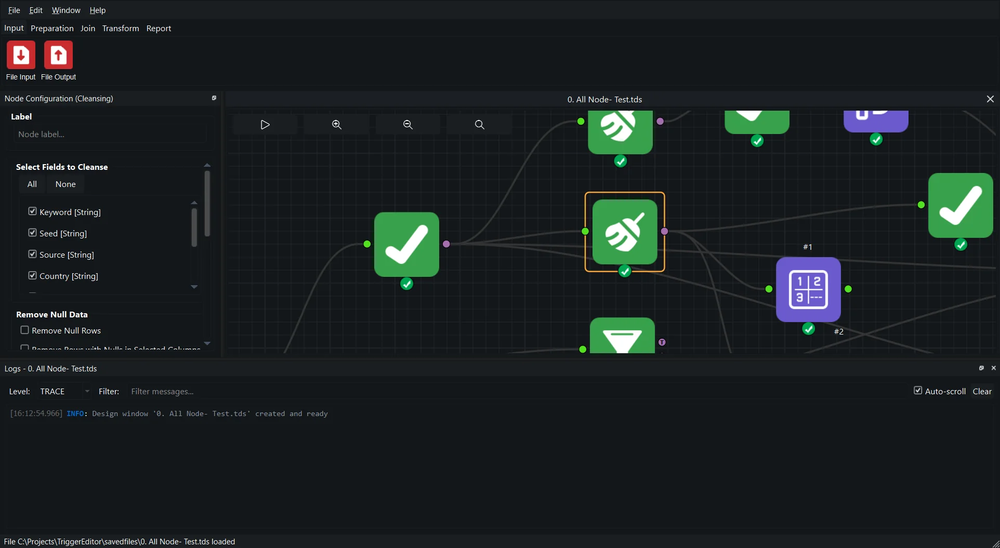

# Trigger Designer

Trigger Designer is a desktop workbench for building data pipelines as a graph of
nodes. You read a file, clean and shape it, test it, and write the result, all on
a canvas. You configure each step in a panel beside the canvas, and the app shows
you the data as you go.

{ .screenshot }

You do not write code to use it. You drag nodes, connect their sockets, and fill
in the settings. Workflows are saved as portable `.tds` files you can share with
a colleague or run unattended from the command line.

## Who it is for

- **Auditors and analysts** who need repeatable checks over ledgers, journals and
  transaction lists.
- **Anyone** who receives a messy spreadsheet or export and needs a clean,
  documented result without writing a script.
- **Reviewers** who must show what was run, on which file, with which settings.

Everything runs on your own computer. Every Run leaves a record you can verify.

## The shape of every pipeline

Most workflows follow the same four steps:

```text
Input  ->  Prepare  ->  Test  ->  Output
read       clean,       audit     write the
the file   shape        checks    result
```

1. **Input.** File Input reads CSV, text, Excel, Parquet, JSON, SQLite or DuckDB.
2. **Prepare.** Preparation nodes fix types, trim text, filter rows, calculate
   columns, sort, aggregate and reshape.
3. **Test.** Audit nodes find duplicates, gaps, Benford outliers and risky
   entries, and draw repeatable samples.
4. **Output.** File Output writes CSV, Parquet, Excel, JSON or NDJSON. Workpaper
   Output builds a formatted Excel workpaper.

Join and Transform nodes sit between these steps when you need to combine tables
or change their shape.

## Start here

<div class="grid cards" markdown>

-   :lucide-rocket: **[Build your first workflow](guide/README.md)**

    ---

    Read a CSV, tidy it and find duplicate orders in about ten minutes.

-   :lucide-layout-dashboard: **[The canvas and nodes](guide/canvas-and-nodes.md)**

    ---

    The screen, the sockets, undo, and how a workflow is wired together.

-   :lucide-layers: **[Node reference](nodes/index.md)**

    ---

    Every node in the palette, with its settings, an example and its messages.

-   :lucide-play: **[Running workflows](guide/running-workflows.md)**

    ---

    What the 100-row preview shows, and what a Run does, step by step.

-   :lucide-triangle-alert: **[Errors and problems](guide/errors-and-problems.md)**

    ---

    Read a message, look up a `TD-` code, fix the workflow.

-   :lucide-history: **[Run history and the audit trail](guide/run-history-and-audit-trail.md)**

    ---

    Show what ran, verify the record, compare two runs.

-   :lucide-file-spreadsheet: **[Workpapers](guide/workpaper.md)**

    ---

    Produce the formatted Excel workpaper and tie it to the run record.

-   :lucide-terminal: **[Command line](guide/cli.md)**

    ---

    Run a saved workflow unattended and read the exit code.

</div>

## Two habits that save trouble

**Preview is a sample.** While you edit, every node works on the first 100 rows.
Counts, totals and audit results in the preview describe that sample. Press
**Run** before you quote a number or hand over a file.

**Click away after typing.** A setting is saved as you type, but the node
recalculates when you select another node or click the canvas. The yellow mark on
a node means a change is waiting to run.
