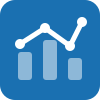

# Report nodes

Report nodes help you look at data. They do not change your data: **Graph** and **Data Profile** pass the table through untouched. To leave a note on the canvas, add a [canvas comment](../../guide/canvas-and-nodes.md#canvas-comments); a canvas comment is not a node.

| If you want to... | Use |
|---|---|
| Draw a line, bar or scatter chart of a table | [Graph](graph.md) |
| Check the quality of a table: nulls, distinct values, text that should be numbers, odd values | [Data Profile](data-profile.md) |

## Nodes in this family

-   { .middle } **[Graph](graph.md)**

    ---

    Charts the incoming data in its own window after a successful Run; passes the data through unchanged.

-   { .middle } **[Data Profile](data-profile.md)**

    ---

    Profiles every column: empty cells, distinct values, ranges, common values and data-quality flags.

---

