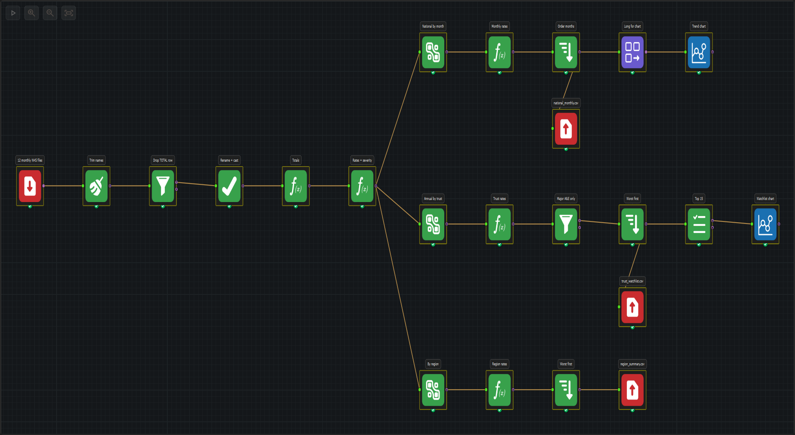
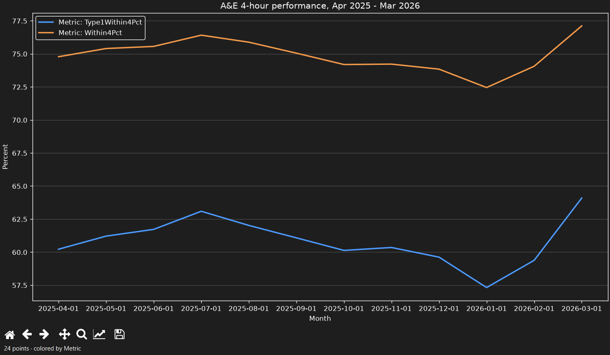
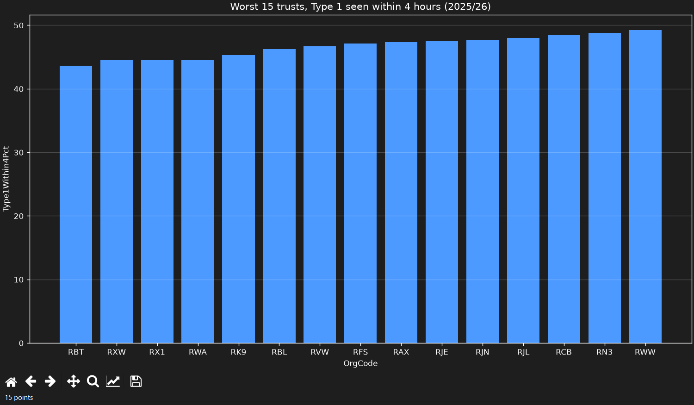

# Example 3 — A&E Winter Watch 2025/26

A real workflow over twelve published NHS England monthly returns. It answers
one question an urgent-care team actually has to answer every year:

> Which major A&E trusts missed the four-hour standard badly enough to need
> escalation, and how did the national position move across the year?

Everything here comes from official statistics. The March 2026 percentages the
workflow produces match the ones NHS England published.



---

## Quick start

```bash
# from the repository root
uv run trigger-designer "savedfiles/Example_3_AE_Winter_Watch/ae_winter_watch.tds"
```

Click the **Run workflow** button (the play icon, top left of the canvas).
The three CSV reports are written to `output/`. The two charts are not drawn
during a run: select a **Graph** node and click **Show graph** in the Config
Dock.

If the repository moves, the File Output paths need rebinding (the app stores
them absolutely). Rebuild the file in place:

```bash
uv run --project . python savedfiles/Example_3_AE_Winter_Watch/build_workflow.py
```

`--run` also executes it headlessly and prints the row counts.

### Refreshing with a new month

The File Input reads the folder, not a fixed file list. Drop the next monthly
CSV into `data/` named `ae-YYYY-MM.csv` and run again. The month is parsed from
the `Period` column, so the national trend extends automatically and the trust
watchlist absorbs the new month. No node needs editing.

---

## What it produces

| File | Rows | What it is |
|---|---|---|
| `output/national_monthly.csv` | 12 | National attendances, breaches, four-hour rate, Type 1 rate, gap to 95%, and twelve-hour waits, for each month Apr 2025 – Mar 2026 |
| `output/trust_watchlist.csv` | 121 | One row per major A&E trust for the full year: annual rates, twelve-hour waits per 1,000 attendances, and a severity band |
| `output/region_summary.csv` | 7 | The same measures rolled up to the seven NHS England regions |





The trust chart labels bars with organisation codes because trust names are
far too long for an axis; `trust_watchlist.csv` carries the name beside each
code.

---

## What the data says

The national all-types figure fell to **72.45%** in January 2026 and recovered
to **77.11%** in March. Type 1 (major A&E) performance is much worse: it fell
to **57.32%** in January and reached only **64.09%** in March. Across the year,
**74.93%** of all attendances and **60.87%** of Type 1 attendances were seen
within four hours.

Twelve-hour waits from decision to admit were **570,957** over the year, with
**71,517** in January alone.

Of the 121 major A&E trusts:

| Severity | Rule (annual Type 1 four-hour rate) | Trusts |
|---|---|---|
| Critical | below 60% | 59 |
| Watch | 60% to 70% | 42 |
| OK | 70% or above | 20 |

No trust met the 95% standard across the year. NHS England reported the same
for March 2026 alone: 0 of 121.

The five weakest trusts on Type 1 performance were Mid Cheshire (43.64%),
Shrewsbury and Telford (44.46%), Nottingham University Hospitals (44.49%),
Hull University Teaching Hospitals (44.52%), and University Hospitals Plymouth
(45.31%).

Shrewsbury and Telford also had the highest twelve-hour wait rate by a clear
margin: **16,915 waits, or 105.5 per 1,000 attendances**, against 83.9 for the
next trust.

At region level the North West had the lowest all-types rate (72.37%). The
South West and North West were level at the bottom on Type 1 (57.70% and
57.71%). London had the best all-types rate (77.23%) but only 62.77% on
Type 1.

---

## The pipeline

23 nodes, 22 edges, three branches from one cleaned spine.

| Label | Node | What it does |
|---|---|---|
| 12 monthly NHS files | File Input | Unions the twelve CSVs in `data/` by column name |
| Trim names | Cleansing | Trims `Period`, `Org Code`, `Parent Org`, `Org name` |
| Drop TOTAL row | Filter | Keeps rows whose `Org Code` is not `TOTAL` |
| Rename + cast | Select | Renames 22 columns to short names and casts 18 of them to `Int64` |
| Attendance totals | Formula | Parses the month, sums the six attendance columns and the six breach columns, and separates Type 1 |
| Rates | Formula | Four-hour percentages, gap to 95%, twelve-hour waits per 1,000, severity band |
| National by month | GroupBy | Sums the counts per month |
| Monthly rates | Formula | Recomputes rates from the monthly sums (not an average of rates) |
| Order months | Sort | Chronological |
| Long for chart | Unpivot | Stacks `Within4Pct` and `Type1Within4Pct` into `Metric` / `Percent` |
| Trend chart | Graph | Line chart, one line per measure |
| national_monthly.csv | File Output | The monthly table |
| Annual by trust | GroupBy | Groups by `Org Code`; keeps the latest name and region; sums counts; counts reported months |
| Trust rates | Formula | Annual rates and severity |
| Major A&E only | Filter | Keeps trusts with Type 1 activity |
| Worst first | Sort | Lowest Type 1 four-hour rate first |
| Top 15 | Select Records | First fifteen rows for the chart |
| Watchlist chart | Graph | Bar chart of those fifteen |
| trust_watchlist.csv | File Output | All 121 trusts, not just the charted fifteen |
| By region | GroupBy | Sums per NHS England region |
| Region rates | Formula | Annual rates per region |
| Worst first | Sort | Lowest all-types rate first |
| region_summary.csv | File Output | The region table |

The two Formula nodes carry the method:

```sql
-- Attendance totals
[AttT1] + [AttT2] + [AttOther] + [BookT1] + [BookT2] + [BookOther]
[OverT1] + [OverT2] + [OverOther] + [OverBookT1] + [OverBookT2] + [OverBookOther]

-- Rates
round(([Attendances] - [Over4]) * 100.0 / [Attendances], 2)
round(([Type1Att] - [Type1Over4]) * 100.0 / [Type1Att], 2)
round([Wait12h] * 1000.0 / [Attendances], 2)
```

---

## Real data, real mess

The files are published by NHS England and are not tidy. Each of these is
handled by the workflow, and each would break a naive script:

| Quirk | What the files do | Where handled |
|---|---|---|
| The England total row is labelled inconsistently | Eleven files set its `Period` to `TOTAL`; February 2026 leaves the month name there. | Filter by `Org Code = TOTAL`, not `Period` |
| Region names carry trailing spaces | 2,080 rows end in a space (`"NHS ENGLAND MIDLANDS "`); London does not. | Cleansing trim, so the region labels match the published names |
| Trusts are renamed mid-year | Four organisation codes change name during the twelve months. | Group by `Org Code`; take the latest name with `Last` |
| CSV arrives as text | All 22 columns are strings, including 18 counts. | Select dtype mapping |
| Providers come and go | 197–201 rows per month; 205 distinct codes across the year. | GroupBy, then count months per trust |
| Booked appointments are additional | The six attendance columns must all be summed to reach the published total. | Attendance/breach totals in Formula |

The two easiest ways to get a wrong number here are (a) filtering on `Period`
and leaving February's total in the data, and (b) grouping trusts by name and
splitting a renamed trust into two rows with half its activity.

---

## Method notes

- **Four-hour rate** = `(attendances − attendances over 4 hours) / attendances`.
  "Attendances" follows the published convention: Type 1 + Type 2 + other
  departments, **plus** booked appointments. Summing all six reproduces NHS
  England's published March percentage.
- **Type 1** means major, consultant-led 24-hour A&E departments. It is shown
  separately because the all-types headline is flattered by Type 3 urgent
  treatment centres and minor injury units, which ran at about 97%.
- **Twelve-hour waits** are delays from decision to admit to admission (the
  "trolley wait" metric in the NHS Constitution), not waits from arrival. They
  are counts of waits, not unique patients. Dividing by attendances gives a
  comparable rate across trusts of different sizes.
- **Annual rates are weighted**: counts are summed and divided once, never
  averaged from monthly percentages.
- **Severity bands** are a demo choice for prioritisation, not an NHS policy
  threshold. The official standard is 95%.

---

## Verification

The March 2026 statistical commentary states 77.1% all-types, 64.1% Type 1,
46,665 waits over twelve hours from decision to admit, and 0 of 121 trusts
meeting the standard. Running this workflow gives:

| Measure | Published | Workflow |
|---|---|---|
| March 2026, all A&E types | 77.1% | 77.11% |
| March 2026, Type 1 | 64.1% | 64.09% |
| March 2026, 12+ hour DTA waits | 46,665 | 46,665 |

NHS England also reported that 0 of 121 trusts met the 95% standard in March
2026. The annual watchlist is a different window, but it also contains no trust
at or above 95%.

The end-to-end test asserts those figures, the watchlist composition, and two
reconciliation properties:

- The seven region rows sum exactly to the national table (`27,976,025`
  attendances).
- The 121 trusts account for every Type 1 attendance and every twelve-hour
  wait (`17,121,495` and `6,699,243`; `570,957`), while covering 90.4% of all
  attendances (the rest are minor-injury units, UTCs and other providers).

```bash
uv run --project . pytest tests/e2e/test_ae_winter_watch.py -q
```

The test materialises the workflow into a temporary directory, rewrites the
input and output paths, runs it through the real GUI execution path, and reads
the written CSVs.

---

## Provenance and licence

Source: NHS England, **A&E Attendances and Emergency Admissions 2025-26**,
monthly activity files.

- Landing page:
  <https://www.england.nhs.uk/statistics/statistical-work-areas/ae-waiting-times-and-activity/ae-attendances-and-emergency-admissions-2025-26>
- Statistical commentary used for the checks:
  [March 2026 commentary (PDF)](https://www.england.nhs.uk/statistics/wp-content/uploads/sites/2/2026/04/Statistical-commentary-March-2026-G4dal2.pdf)
- Data downloaded 28 October 2026. The published files were renamed to
  `ae-YYYY-MM.csv` so folder-union order is chronological; contents are
  unchanged.

| Local file | Published file |
|---|---|
| `ae-2025-04.csv` | [April 2025 CSV](https://www.england.nhs.uk/statistics/wp-content/uploads/sites/2/2025/11/April-2025-CSV-revised.csv) |
| `ae-2025-05.csv` | [May 2025 CSV](https://www.england.nhs.uk/statistics/wp-content/uploads/sites/2/2025/11/May-2025-CSV-revised.csv) |
| `ae-2025-06.csv` | [June 2025 CSV](https://www.england.nhs.uk/statistics/wp-content/uploads/sites/2/2025/11/June-2025-CSV-revised.csv) |
| `ae-2025-07.csv` | [July 2025 CSV](https://www.england.nhs.uk/statistics/wp-content/uploads/sites/2/2025/11/July-2025-CSV-revised.csv) |
| `ae-2025-08.csv` | [August 2025 CSV](https://www.england.nhs.uk/statistics/wp-content/uploads/sites/2/2025/11/August-2025-CSV-revised.csv) |
| `ae-2025-09.csv` | [September 2025 CSV](https://www.england.nhs.uk/statistics/wp-content/uploads/sites/2/2025/11/September-2025-CSV-revised.csv) |
| `ae-2025-10.csv` | [October 2025 CSV](https://www.england.nhs.uk/statistics/wp-content/uploads/sites/2/2026/05/Monthly-AE-October-2025-revised-fly02sk.csv) |
| `ae-2025-11.csv` | [November 2025 CSV](https://www.england.nhs.uk/statistics/wp-content/uploads/sites/2/2026/05/Monthly-AE-Nov-25-CSV-revised.csv) |
| `ae-2025-12.csv` | [December 2025 CSV](https://www.england.nhs.uk/statistics/wp-content/uploads/sites/2/2026/05/Monthly-AE-December-2025-revised-g9Hy6.csv) |
| `ae-2026-01.csv` | [January 2026 CSV](https://www.england.nhs.uk/statistics/wp-content/uploads/sites/2/2026/05/Monthly-AE-January-2026-revised-3dker.csv) |
| `ae-2026-02.csv` | [February 2026 CSV](https://www.england.nhs.uk/statistics/wp-content/uploads/sites/2/2026/03/February-2026-CSV-Dl8t54.csv) |
| `ae-2026-03.csv` | [March 2026 CSV](https://www.england.nhs.uk/statistics/wp-content/uploads/sites/2/2026/05/Monthly-AE-March-2026-revised-flkg42.csv) |

Contains public sector information licensed under the
[Open Government Licence v3.0](https://www.nationalarchives.gov.uk/doc/open-government-licence/version/3/).
The Open Government Licence permits commercial and non-commercial reuse with
attribution.

---

## Caveats

- **Annual, not a snapshot.** The watchlist aggregates the full twelve months.
  A trust that improved sharply by March still carries its winter in the annual
  rate. The monthly national table is the place to see the trajectory.
- **Reporting completeness.** 121 trusts reported a Type 1 department in all
  twelve months. Trust mergers and new organisations can change that.
- **Wait counts are activity, not people.** A patient delayed twice is counted
  twice; the metric is the published one.
- **Output paths are absolute** in the `.tds`. Re-run `build_workflow.py` after
  moving the checkout. Inputs are stored relative to the workflow and travel
  with it.
- **The charts need a click.** A run is data-only by design; open each Graph
  node's dock and choose **Show graph**.
